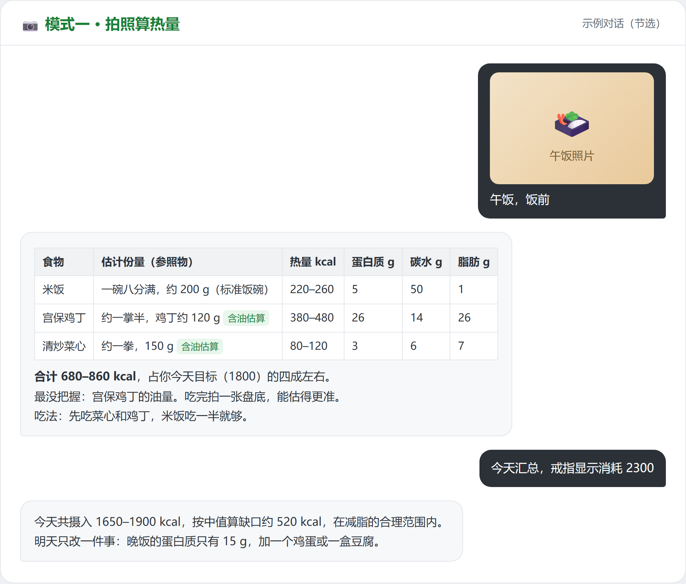
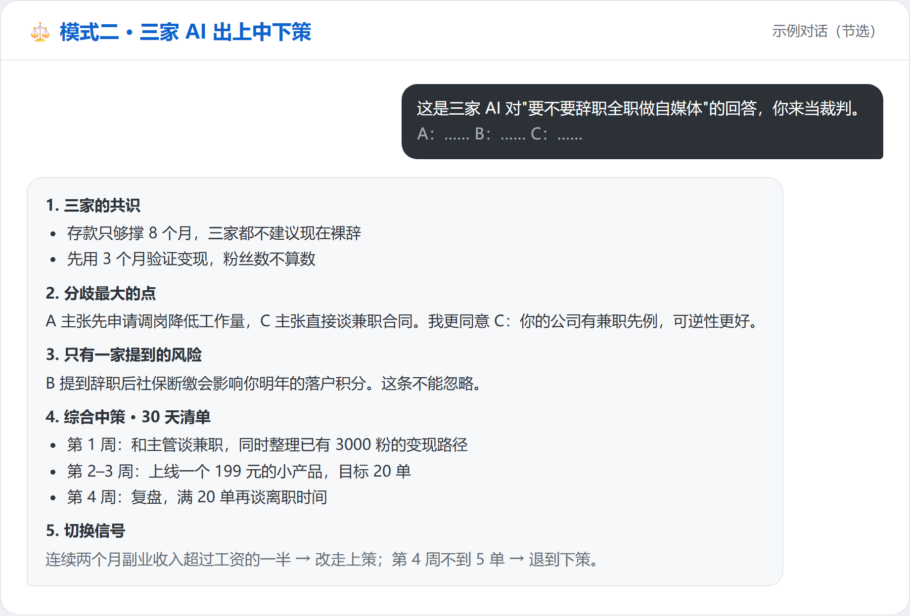
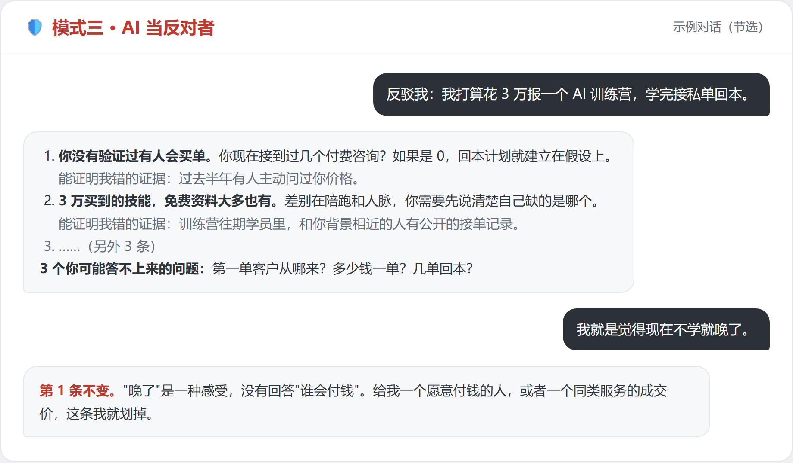
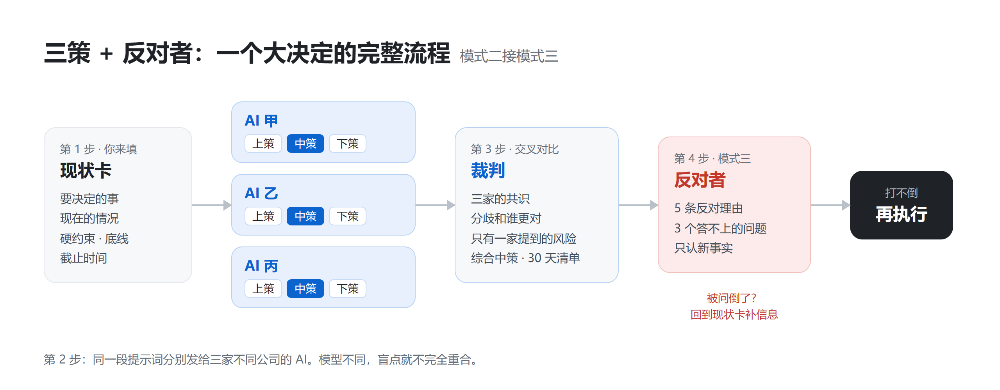

# wr-sunkit

[← 返回 wr-skills](../../README.md) · [English](../../README.en.md#wr-sunkit)

> 把 AI 当成你的营养师、军师和反对者。拍照算热量、三家 AI 出上中下策、让 AI 专门反对你，三件事装进一个 Skill。

**支持：Claude Code、Codex、claude.ai，以及其他支持 Skills 的 Agent。** 用的 AI 不支持 Skill，也可以直接复制 [提示词清单](提示词清单.md)。

[快速开始](#快速开始) · [三个模式](#三个模式) · [安装](#安装) · [提示词清单](提示词清单.md) · [注意事项](#注意事项) · [SKILL.md 原文](../../skills/wr-sunkit/SKILL.md)


## 这是什么

灵感来自孙宇晨在一次长访谈里讲的日常 AI 用法：每餐前后拍照让 AI 算热量；遇到事情把现状交给三个 AI，取中策；所有记录存成 Markdown，换一家 AI 也能接着用。

wr-sunkit 把这几件事整理成可以直接装进 Agent 的 Skill，并补上了"让 AI 当反对者"，专门对付 AI 爱顺着你说的毛病。具体的提示词和流程是本仓库按这个思路写的，并非访谈原文。

> 本项目是个人整理的开源工具，与孙宇晨本人及其关联机构没有任何关系。

| 你的处境 | 你会得到 |
| --- | --- |
| 想控制饮食，但懒得查热量表、记不住吃了什么 | 拍一张照片就有热量区间和三大营养素，睡前一张日汇总 |
| 面对一个大决定，问了一个 AI，总觉得它说的不全 | 一份能直接发给三家 AI 的提示词，加一个替你交叉对比的裁判 |
| 想听真话，AI 却总说"这个想法很好" | 一个只找失败理由、你嘴硬它也不让步的反对者 |
| 换了一家 AI，之前的记录全没了 | 所有记录都是 Markdown，换谁都能接着用 |

## 快速开始

装好后不用先选 Skill，直接说话。Agent 会根据你说的内容自动进入对应模式：

```text
[发一张饭菜照片] 午饭，饭前
```

```text
我在纠结要不要辞职全职做自媒体，帮我准备一份发给三家 AI 的提示词。
```

```text
反驳我：我打算花 3 万报一个 AI 训练营，学完接私单回本。
```

没有自动进入时，可以点名调用。Claude Code 里输入 `/wr-sunkit`（通过插件市场安装时是 `/wr-sunkit:wr-sunkit`），其他 Agent 里说"用 wr-sunkit"。

## 三个模式

### 📷 模式一：拍照算热量

第一次用时，它会问你身高、体重和目标，算出每日目标摄入。之后：

- **饭前拍一张**：逐样列出食物、份量（用饭碗、手掌、筷子做参照）、热量区间和蛋白质、碳水、脂肪，再告诉你这顿怎么吃
- **饭后拍一张**：对比饭前，估你实际吃掉多少
- **睡前说"汇总"**：一天的总摄入；给了手环或戒指的消耗数据，就帮你算热量缺口；只给一条明天最该改的建议

热量一律给区间，炒菜按家常用油量计入，看不清的食物会写"疑似"并让你确认。



### ⚖️ 模式二：三家 AI 出上中下策

1. **整理现状卡**：从你的描述里提取要决定的事、现状、约束、底线和截止时间，缺什么追问什么
2. **生成提示词**：一段可以直接复制的提示词，让你分别发给三家不同公司的 AI，每家都出上策、中策、下策
3. **当裁判**：你把三份回答贴回来，它列出三家的共识、分歧、只有一家提到的风险，最后给出综合中策和 30 天行动清单，以及什么情况下该改走上策或退到下策

为什么要三家：不同公司的模型训练方式不同，盲点不完全重合。一个 AI 自己扮演三个顾问，盲点还是同一套。



### 🛡️ 模式三：AI 当反对者

- 不说"这个想法很好，但是……"，直接给 5 条最有力的反对理由，按会不会让整件事失败排序
- 每条附上"什么证据能证明这条反对是错的"
- 最后问你 3 个可能答不上来的问题
- 你拿出新事实，它才划掉一条；你只是坚持立场，它继续反对

还可以让它做**事前验尸**（假设一年后失败了，倒推失败路径），或者**换立场**（以老板、投资人、最挑剔的用户的身份反驳你）。



### 三个模式怎么串起来

遇到大决定时，三策和反对者可以连着用：三家出方案，裁判整理出中策，再让反对者打一轮，打不倒再执行。



## 安装

```bash
npx -y skills add Hestamen/wr-skills -g --skill wr-sunkit
```

Claude Code 插件市场、claude.ai 上传、手动安装等其他方式，见 [wr-skills 的安装说明](../../README.md#安装)。

### 不支持 Skill 的 AI

ChatGPT、豆包、Kimi 等，可以直接用 [提示词清单](提示词清单.md)，每段都能复制过去用；也可以把 [SKILL.md](../../skills/wr-sunkit/SKILL.md) 的正文贴进它们的自定义指令。

## 记录存在哪

所有记录都是 Markdown。Agent 能写文件时，第一次会问你存在哪，之后沿用：

```text
你指定的文件夹/
├── profile.md              # 身高体重、目标、忌口
└── food-log/
    ├── 2026-10-10.md       # 每天一份饮食记录
    └── 2026-10-11.md
```

不能写文件的环境（比如网页聊天），它会在回复末尾给出完整的 Markdown，你自己存一下，下次贴给任何一家 AI 都能接着用。

## 注意事项

- **热量是估算**。拍照估热量的误差常在两三成，油、酱料、汤汁最容易低估。看一周的趋势比看单餐数字更有用。
- **不替代医生**。孕期、慢性病，或者对数字焦虑、有节食倾向时，Skill 会停止给热量目标，请找医生或营养师。
- **注意隐私**。发给 AI 的现状卡里，别放身份证号、银行账户、病历原件，用区间或代称就够了。
- **决定还是你做**。三策和反对者帮你看得更全，结果由你自己判断和承担。

## 授权

[CC BY-NC 4.0](../../LICENSE)。可以免费使用、分享和修改，须注明作者 Windrise AI 和仓库链接；禁止商用，包括包装进付费课程、训练营、付费社群或付费资料包。详见 [授权说明](../../README.md#授权)。
